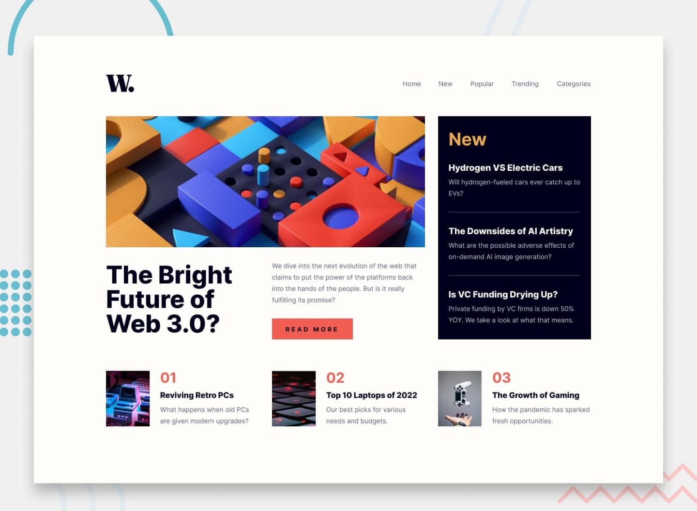

# Frontend Mentor - News homepage

A responsive news homepage built as a Frontend Mentor challenge using HTML and Tailwind CSS.

## Overview

The page features a main news article, a sidebar with the latest news, and three additional article cards. The layout adapts to different screen sizes, including mobile and desktop.

## Built With

- HTML5
- Tailwind CSS
- Google Fonts — Inter

## Features

- Responsive layout for mobile and desktop screens
- Mobile navigation menu
- Featured news article
- Latest news sidebar
- Three additional news article cards
- Hover effects on navigation links and article titles

## Getting Started

1. Clone this repository.
2. Open the project folder in Visual Studio Code.
3. Open `index.html` using Live Server.

## Challenge

[Frontend Mentor — News Homepage](https://www.frontendmentor.io/)

## Author

Sumeya Seid

- GitHub: [@Sumeya472](https://github.com/Sumeya472)
